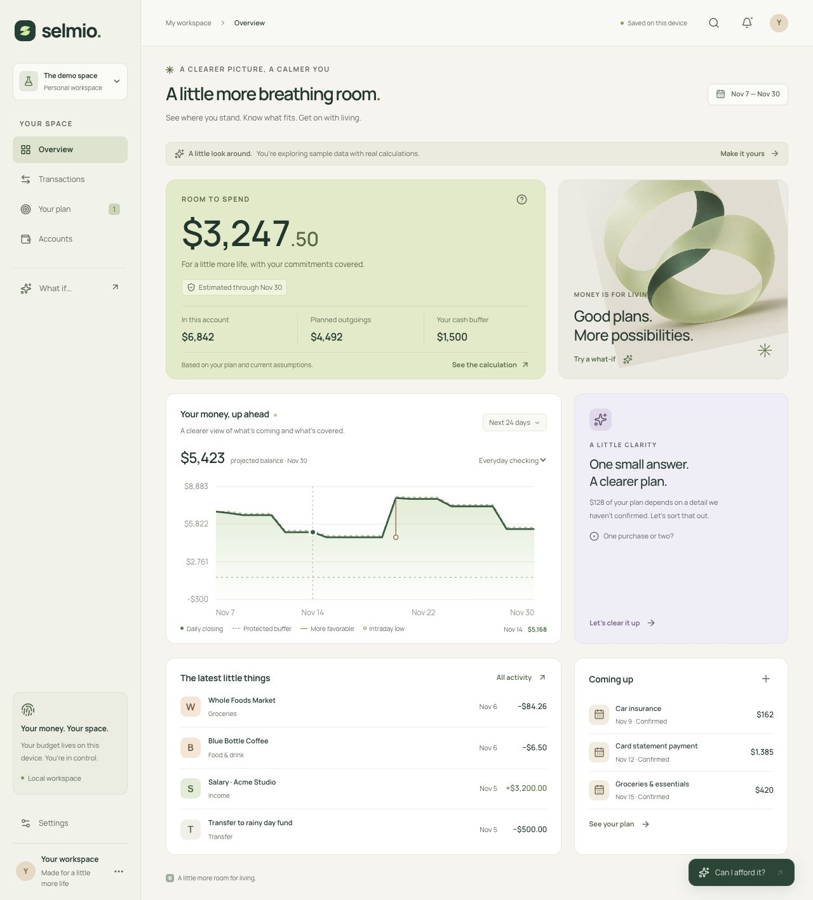

# Selmio

**Know what fits.** A little more breathing room for your money.

Selmio is an MIT-licensed local budgeting application. It makes dated spending decisions inspectable: accounts, upcoming commitments, a protected cash buffer, and explicit alternatives all contribute to the answer. The initial demo uses fictional accounts and transactions; calculations are real.



## Web preview

Try [Selmio on GitHub Pages](https://nimeshbuilds.github.io/selmio/). The browser version includes the budgeting tools, manual accounts, CSV import, and JSON backups. Workspaces stay in your browser and are not encrypted. Bank linking requires the local app and its private connector.

Choose **Scenarios** or **Try 10 scenarios** for guided practice with fictional money. Each walkthrough explains what to do, opens the actual controls, and describes the result to look for. Practice workspaces stay separate from your personal workspace; **Exit practice** returns to your own budget. Practice changes reset when you reload, while the list of walkthroughs you mark explored stays in this browser.

The [Pages workflow](.github/workflows/pages.yml) checks and publishes the static app after pushes to `main`. To build and preview the same static version locally:

```sh
npm run build:pages
npm run preview:pages
```

Open **http://127.0.0.1:4175/selmio/**. The static entry is in `web-preview/`; it reuses the same interface and financial engine. Its build excludes the server routes and disables bank requests. Set `PAGES_BASE_PATH` when publishing under a different URL prefix.

## Run

Requires Node.js 22.13 or newer and npm.

```sh
npm ci
npm run dev
```

Open **http://127.0.0.1:3000**. The app starts with clearly labeled sample data. Select **Make it yours** to start a personal workspace. You can add accounts, import CSV statements, add bills/paydays/goals, adjust your buffer, test purchases, resolve explicit alternatives, and export/restore JSON backups.

## Optional bank connection

The **Connect with Plaid** interface uses official Plaid Link and a private local connector. No credentials are bundled. Copy `.env.example` to `.dev.vars`, configure it, and restart `npm run dev`; the command starts the connector automatically when configured. Sandbox contains simulated accounts. Real institutions require Production approval and credentials. See [Plaid setup and boundaries](docs/PLAID.md).

Core budgeting works without Plaid or an AI API key. Connecting through Plaid sends financial data through Plaid and the configured connector. The default development configuration is loopback-only; it is not a hosted multi-user service.

## What works

- Responsive dashboard, dated cash forecast, transactions, account views, and editable commitments.
- Purchase scenarios with conservative/favorable bounds and an inspectable calculation.
- Integer USD cents, dated obligations, and separate balance anchors so history is not charged twice.
- Explicit ambiguity review: the demo authorization can be one purchase or a distinct extra charge.
- Atomic CSV imports with strict dates, quoted fields, duplicate detection, and stable-ID updates.
- Local persistence, backup export/restore validation, and optional Plaid sync.
- Self-hostable Plaid connector with server-only credentials, signed browser sessions, Origin checks, and atomically persisted full snapshots/cursors.

## Important implementation boundaries

This is an initial working implementation, not an audited financial system. Affordability depends on the balances, commitments, and modeled alternatives supplied. Unknown obligations are not automatically discovered. Expected income can fail to arrive. Results are conditional, not guarantees.

The current engine bounds independently specified additional outflows. It does **not** implement the proposed research algorithm for automatically inferring and compressing correlated financial interpretations. No patentability, invention novelty, bank-coverage, or production-readiness claim is made.

Account balances are snapshots. Historical imports do not update them. Enter the current balance for manual accounts; keep it current. Card repayments should be added as checking-account commitments when relevant. The app does not automatically derive credit-card statements, loan interest splits, or recurring schedules.

The browser workspace is stored in localStorage and is **not encrypted**. Export regular private backups. Clearing browser storage removes this copy. The optional connector stores tokens and imported snapshots in gitignored `.local-data/` with restricted file permissions; these files are also not encrypted. Do not use a shared browser profile for sensitive data. See [security](SECURITY.md).

Only USD checking, savings, and credit-card data is supported by the first bank-import adapter. Unsupported accounts, missing balances, and unknown currencies are reported instead of silently converted.

## Checks

```sh
npm test
npm run typecheck
npm run build
```

Tests cover accounting boundaries, intraday low balances, purchase timing, uncertainty resolution, CSV ingestion, bank-data normalization, backup validation, and a mocked connector. Live-bank operation requires separate verification with configured credentials.

See the [validation record and screenshots](docs/VALIDATION.md) for browser checks and remaining verification.

## Project

- [Brand assets and guidance](docs/BRAND.md)
- [Roadmap](docs/ROADMAP.md)
- [Contributing](CONTRIBUTING.md)
- [Security](SECURITY.md)
- [MIT license](LICENSE)

Brand assets are in `public/brand/`, including editable SVG marks, a wordmark, app icon, social card, and generated artwork. The initial name screen is not trademark or domain clearance.

The app is built with React, TypeScript, and the Vinext/Vite local development runtime. The Sites starter's hosting integration remains in the source, but this project has not been registered or published as a hosted Site. A public deployment needs a separately designed identity and storage boundary.
